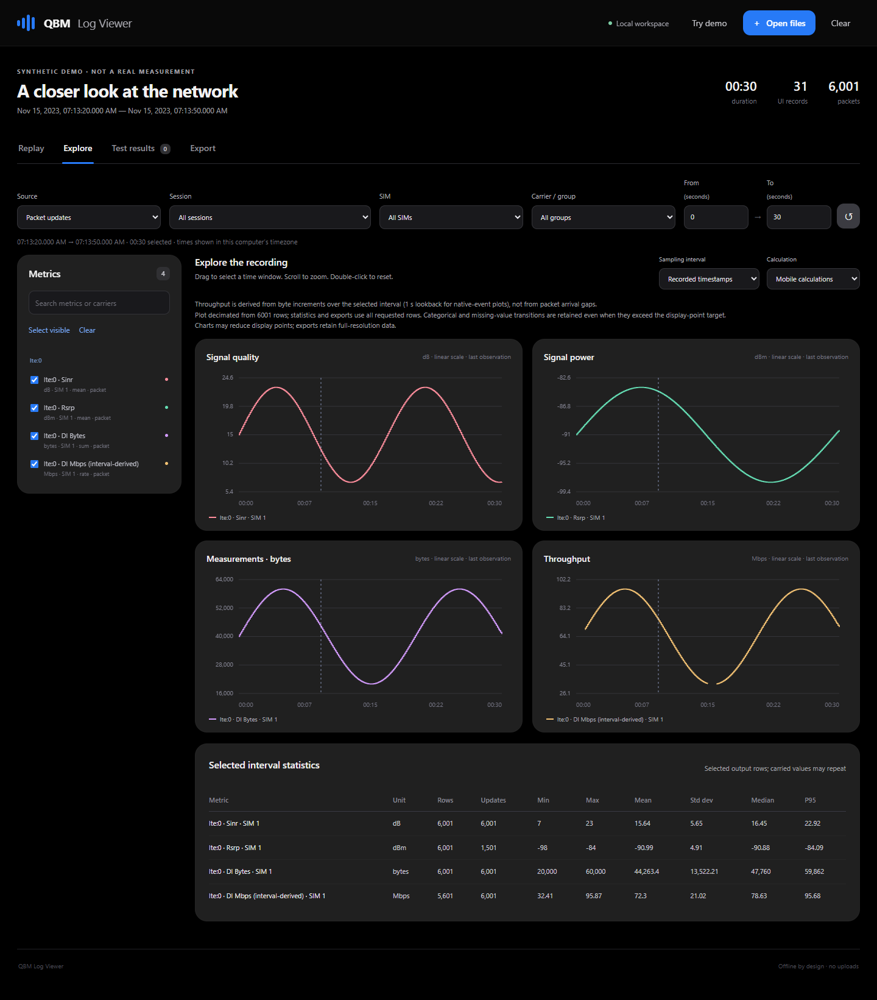
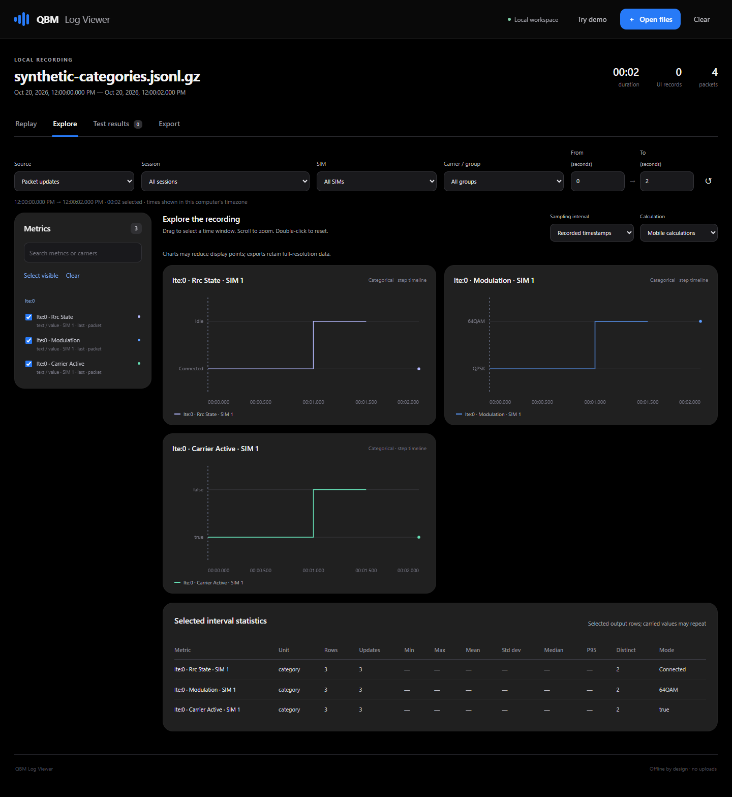

# QBM offline log viewer

Open **index.html** in a current desktop Chrome, Edge or Firefox. Keep all files in
this directory together. No build, account, server or runtime package installation
is required. Logs are read locally; there are no analytics, CDN assets or uploads.
The supplied demo is synthetic and is labeled accordingly.





If your browser or enterprise policy blocks local workers, the viewer can use its
main-thread fallback. Alternatively, serve this directory locally:

```console
python -m http.server 8080 --bind 127.0.0.1
```

Then open `http://127.0.0.1:8080`. This serves the application files; the browser's
file picker still reads log contents locally.

## Record on Android

In the mobile app's Network menu, open **Save network logs**. Choose a folder with
the system document picker; for a removable SD card, choose or create a subfolder.
Android may disallow selecting a storage volume's root. Enable Qualcomm packets
when packet-rate measurements and original weighted aggregation evidence are
needed, then start recording. Stop recording to finish the last gzip segment.

Recording is independent of the temporary replay switch and its one-hour cache.
It continues polling while its foreground service is active. The app writes
independently compressed `.jsonl.gz` segments at approximately 30 seconds or 8 MiB
of uncompressed data. Copy the session's files to your PC and open them together.
Earlier closed segments survive an interruption; a damaged final segment may be
partially recoverable and is flagged. Storage errors and dropped records are
visible; an archive never silently claims that missing observations were measured.

## Replay and explore

- **UI samples** shows the stored logical mobile snapshots at their actual
  publication timestamps, including processed values, carrier tables, antennas,
  neighbors and presentation settings. It does not assume a perfect 1 Hz cadence
  or recreate animation frames.
- **Packet updates** uses each received Qualcomm DIAG packet's host BOOTTIME
  timestamp. Asynchronous values are synchronized with last observation carry
  forward. Initial unknowns remain null; carrier changes and known gaps clear
  carried state. A packet may contain multiple records/TBs: the archive preserves
  original bytes and weighted statistics without inventing subpacket timestamps.
- Choose a session, SIM, carrier, metrics and time interval. Charts update on
  selection. Drag a chart to select a time window, scroll to zoom, double-click to
  reset, or use the playback controls and scrubber. Metrics with different units
  have separate plots. Categorical values such as RRC state and modulation use
  step timelines with their original labels. Rows in the statistics table describe the selected output;
  **Updates** counts original observations, while **Rows** can include carried
  values repeated by synchronization.

The mobile app does not average everything. **Mobile calculations** combines
recorded sums/counts for means, TB failures/counts for BLER, ordered category votes
for modes, the last value for configuration, and byte increments over elapsed time
for rates. LTE transmission mode selects its winning raw scheme before mapping
to TM. **Carry forward** instead samples the last known values on a chosen grid.
Neither method uses future observations. Plot decimation preserves extrema and
does not reduce exported data or the statistics input.

Packet DL/UL bytes and derived Mbps are separate fields. Rates use the explicit
selected interval, or a complete 1-second lookback for native-event plots; a
packet's arrival gap is not a throughput denominator. UI-only data cannot recover
packet detail inside an aggregated polling window. Available window weights are
used for coarsening; fields without aggregation provenance retain recorded values.

## Export

Select the dataset, fields, time range, interval and calculation, then choose CSV,
JSON or NDJSON. `0 ms` keeps source event timestamps. The preview shows the first
rows and total row count. Null stays unavailable. JSON/NDJSON include column
metadata and notes; test exports also include their raw-attempt assessments.
CSV strings are escaped and spreadsheet formula prefixes are neutralized.
Original packet bytes remain in the source `.jsonl.gz` archives.
Native exports also retain original nanosecond/modem timestamps and sequence
metadata. Import those CSV columns as text in spreadsheets to preserve all digits;
JSON/NDJSON retain them as strings automatically.

Time ranges include their endpoints. For an interval grid, aggregates after the
first row cover the preceding open-left, closed-right interval; a final partial
interval ends at the selected end time. The first row can show an instantaneous
state but has no newly inferred throughput interval. A bucket crossing a known
gap/reset is marked incomplete. Same-time native events retain their sequence in
exports even though their display timestamps may coincide.

For predictable browser memory use, one import is limited to 512 MiB decompressed,
750,000 records and 3 million decoded updates. Queries/exports are limited to
500,000 rows and 2 million selected cells. Open fewer segments, choose fewer
fields, or increase the interval for larger captures. The limits produce an
explicit error rather than silently truncating an export. The parser indexes
decoded values, not duplicate copies of the archive's raw packet hex.

## Test results and targets

Open exported mobile NBTC/MIC test-report JSON or CSV, optionally alongside modem
recordings. This format is produced by the separate [test-script PR #7](https://github.com/Fronsipswu/qcom-band-menu/pull/7).
The viewer can be reviewed and used independently of that PR. MIC campaign JSON
exports containing original point trials are also accepted.

The Test results tab plots attempts, computes statistics and recomputes NBTC
session target checks from the raw evidence. Positive margins mean the observed
value is on the acceptable side of the target; percentage differences are shown
in **percentage points (pp)**. Cancellations are excluded, ordinary failures stay
in the correct denominators, and instrument/content verification problems are
identified. FTP bitrate qualification uses successful transfers as its denominator.
Chart smoothing and export resampling never change regulatory assessments.

NBTC targets follow the [governing standard and 2024 measurement guidance](https://standard.nbtc.go.th/Standards/มาตรฐานคุณภาพการให้บริการ-(QOS).aspx).
The [July 2015 MIC guideline](https://www.soumu.go.jp/main_content/001056443.pdf)
defines methodology and distributions, **not minimum-speed pass/fail thresholds**.
MIC views show method checks, three-trial point means and campaign min/Q1/median/
Q3/max where original evidence is available. Incomplete/duplicate points are not
converted to zero or silently selected as the best visit. CSV point means are
provisional because the mobile CSV does not carry a session-completion marker.
Optional user-defined targets are labeled separately from MIC/NBTC requirements.

These are local measurement assessments. Server qualification, geographic
coverage, annual/quarterly obligations and operator-wide certification require
campaign review. No GPS, SMS/MMS or call-test features are added.

## Development checks

The viewer has no runtime dependencies. With Node 18 or newer:

```console
npm test
```

The pure tests cover synchronization, clock precision, resets/gaps, weighted
aggregation, throughput, native ordering, exports, and regulatory calculations.
They include a gzip fixture produced by the actual Kotlin archive writer and a
fixture emitted by the native C decoder from synthetic packets.

For optional browser QA, install `playwright-core` in a separate test environment
and set `QBM_PLAYWRIGHT_PATH` to that module's path and `QBM_BROWSER_PATH` to an
installed Chromium browser. Then run `node tests/browser-qa.cjs`.
`QBM_QA_OUTPUT` chooses where screenshots and test downloads are written. The QA
uses `file://` with ordinary browser security settings and checks for external
HTTP requests. Physical Qualcomm devices and real SD-card providers still need
on-device verification.

The full archive schema and clock/aggregation contract are in
[app/LOG_FORMAT.md](../app/LOG_FORMAT.md). Native regression tests run with
`python3 app/binary/tests/test_capture.py` on a POSIX host (WSL is supported).
